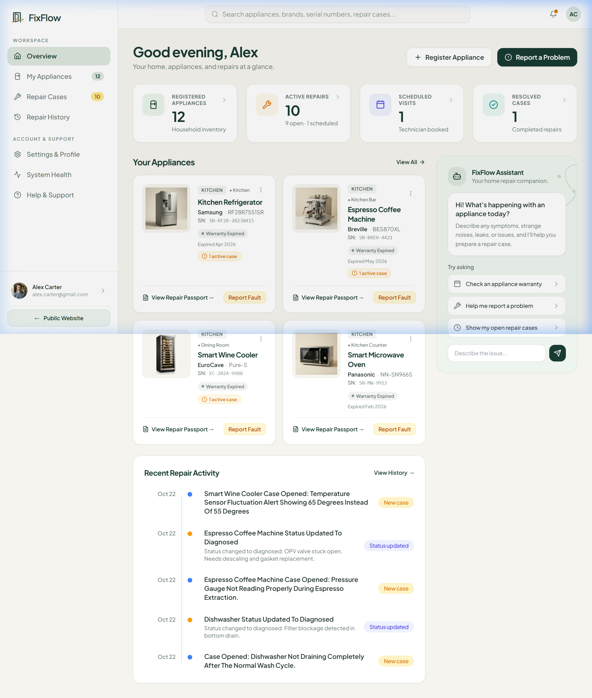
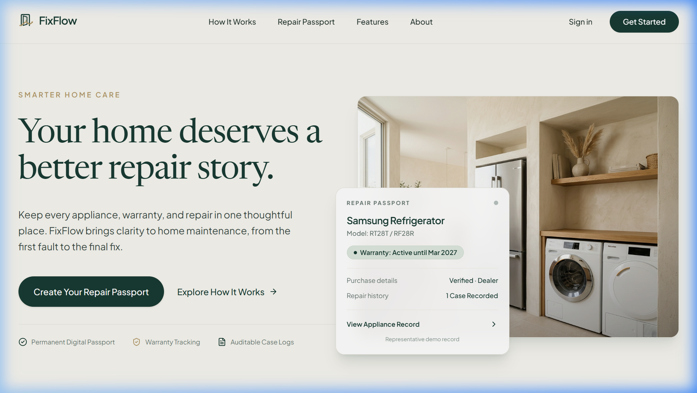
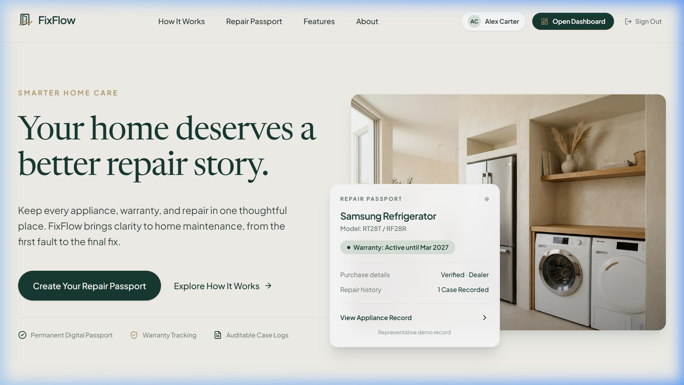
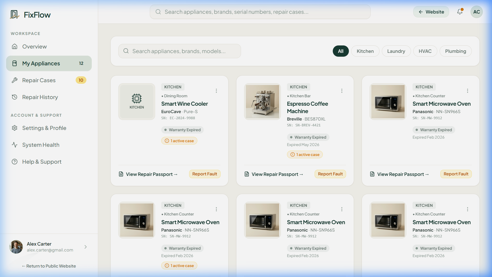
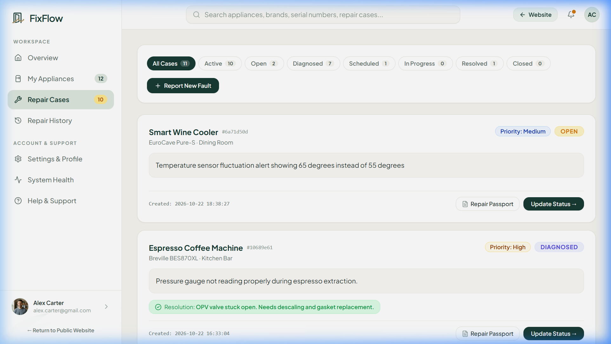
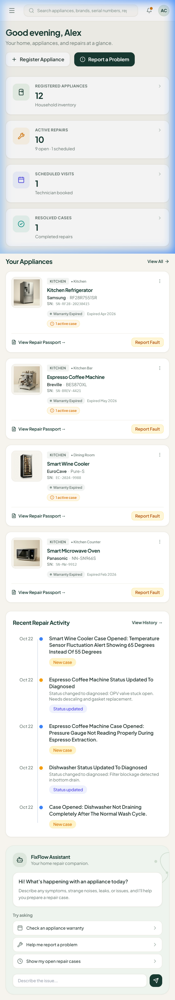
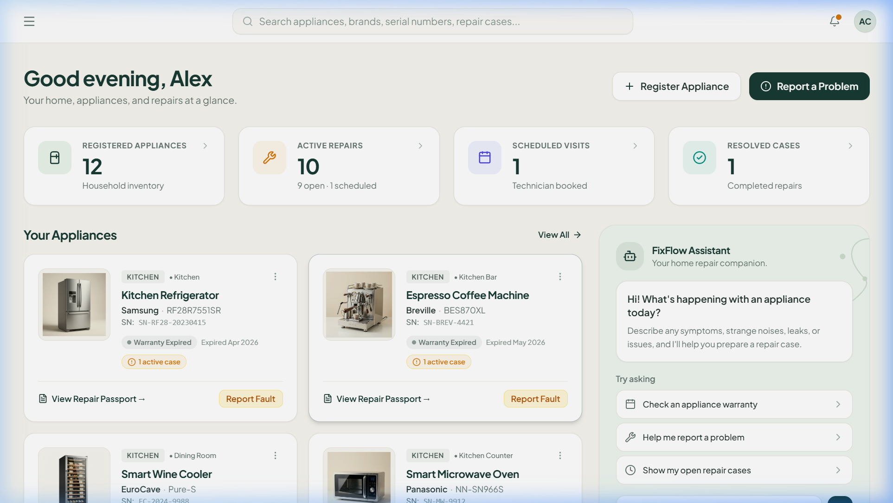
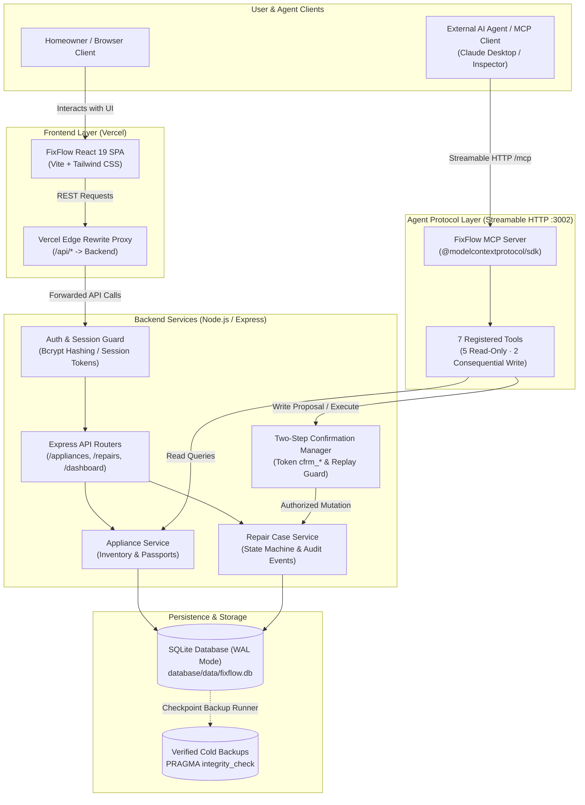

<div align="center">

  

  # FixFlow — Smarter Home Care
  ### Smarter Home. Simpler Repairs.

  A modern home repair management platform bringing together appliance inventory, real-time warranty tracking, immutable **Digital Repair Passports**, and an agentic foundation for conversational repair diagnostics.

  [](https://fixflow-ai-home-repair-agent-two.vercel.app/)
  [](https://github.com/Tharunnagabramhagna/fixflow-ai-home-repair-agent)
  [](https://github.com/Tharunnagabramhagna/fixflow-ai-home-repair-agent)

  <br />

  <!-- Technology Badges -->
  <p align="center">
    
    
    
    
    
    
    
    
    
    
    
  </p>

  <p align="center">
    <a href="#product-preview">Product Preview</a> •
    <a href="#about-fixflow">About FixFlow</a> •
    <a href="#key-features">Key Features</a> •
    <a href="#technology-stack">Tech Stack</a> •
    <a href="#architecture">Architecture</a> •
    <a href="#getting-started">Getting Started</a> •
    <a href="#mcp-integration">MCP Integration</a> •
    <a href="#testing--quality-assurance">Testing</a> •
    <a href="#current-limitations--roadmap">Roadmap</a>
  </p>

</div>

---

## Product Preview

FixFlow delivers a clean, responsive interface designed for homeowners, property managers, and repair technicians.

<div align="center">
  
  <p><em>Desktop Overview — Centralized appliance inventory, active repair cases, warranty summaries, and diagnostic activity.</em></p>
</div>

<br />

### Public Exploration & Authenticated Homeowner Workspace

| Guest Exploration & Landing Experience | Authenticated Homeowner Dashboard |
| :---: | :---: |
|  |  |
| *Interactive guest exploration with curated sample appliances.* | *Authenticated homeowner dashboard with private household records.* |

<br />

### Appliance Inventory & Repair Lifecycle Management

| Appliance Inventory & Digital Repair Passports | Repair Case Workflow & Status Lifecycles |
| :---: | :---: |
|  |  |
| *Appliance inventory with real-time warranty badges and brand/model indexing.* | *Active repair case tracker with validated status lifecycle transitions.* |

<br />

### Responsive Experience Across Form Factors

| Mobile Dashboard (390 × 844) | Responsive Sidebar & Household Controls |
| :---: | :---: |
|  |  |
| *Fully responsive mobile layout with optimized touch navigation.* | *Collapsible navigation drawer with session switching and system status.* |

---

## About FixFlow

### The Problem
Home appliance care is notoriously fragmented:
- **Scattered records:** Purchase receipts, manuals, and warranty documentation are misplaced or lost across paper drawers and disorganized emails.
- **Lost repair context:** When an appliance breaks down, homeowners rarely recall prior service dates, replaced parts, or recurring symptoms.
- **Wasted time & money:** Homeowners pay for out-of-pocket repairs on appliances that are still under warranty because coverage dates are difficult to track.
- **Inaccurate troubleshooting:** Service calls often begin without serial numbers, exact model codes, or clear fault timelines, leading to repeated contractor visits.

### The Solution
**FixFlow** centralizes home maintenance into a single, cohesive system of record:
1. **Persistent Digital Repair Passports:** An immutable digital record for each appliance logging lifetime maintenance events, diagnostic notes, and fault timelines.
2. **Automated Warranty Tracking:** Instant calculation of active vs. expired status based on stored purchase dates and warranty terms.
3. **Structured Repair Lifecycles:** Clear case tracking through validated lifecycle states (`open` &rarr; `diagnosed` &rarr; `scheduled` &rarr; `in_progress` &rarr; `resolved` &rarr; `closed`).
4. **Agentic Protocol Foundation:** Built-in Model Context Protocol (MCP) server exposing 7 structured repair tools via Streamable HTTP, enabling external AI agents and voice assistants to query records and safely propose repair actions with homeowner confirmation.

---

## Key Features

### 📋 Digital Repair Passport
Every registered appliance receives a dedicated **Digital Repair Passport**:
- Comprehensive device specifications: category, brand, model, serial number, and room location.
- Live warranty status evaluation (active coverage vs. expired, with remaining days).
- Chronological timeline of all diagnostic events, technician observations, and status changes.
- Uploaded warranty documentation and receipt association.

### 🏠 Appliance Inventory Management
- Categorize household devices across Kitchen, Laundry, HVAC, Plumbing, and Living spaces.
- Fast query and search across appliance names, model numbers, serial tags, and room locations.
- Distinct sample catalog for guest exploration alongside isolated private appliances for authenticated users.

### 🔧 Repair Case Lifecycle & Status Management
- Submit structured fault reports with diagnostic descriptions, severity levels (`low`, `medium`, `high`, `urgent`), and scheduling notes.
- Strict state-transition enforcement: prevents invalid jumps or modifications to terminal closed cases.
- Deterministic event logging: every state transition writes an immutable audit record with timestamps.

### 🛡️ Warranty Coverage Tracking
- Real-time calculation of remaining warranty coverage days.
- Visual status indicators throughout dashboard cards and passport views.
- Prevents unnecessary repair expenses by highlighting active manufacturer coverage before booking service.

### 👤 Guest Exploration & Homeowner Authentication
- **Guest Exploration:** Visitors can immediately test FixFlow's interface, inspect sample appliances, and review sample passports without creating an account.
- **Authenticated Sessions:** Secure password hashing (bcrypt), token-based session management, and strict cross-user data isolation ensuring private household data remains completely confidential.

### 🤖 Conversational MCP Repair Tools
FixFlow includes an official **Model Context Protocol (MCP)** server (`mcp-server/`) exposing seven structured tools:
- **`search_appliances`** *(Read-Only)*: Search appliances by query text or category filter.
- **`get_repair_passport`** *(Read-Only)*: Retrieve complete appliance dossier, history, and warranty records.
- **`check_warranty`** *(Read-Only)*: Evaluate active/expired status and days remaining.
- **`list_repair_cases`** *(Read-Only)*: Query cases filtered by lifecycle status or appliance ID.
- **`get_repair_case`** *(Read-Only)*: Fetch specific case details and chronological event log.
- **`create_repair_case`** *(Consequential Write)*: Requires authenticated session, duplicate detection, and two-step confirmation token (`cfrm_*`).
- **`add_repair_note`** *(Consequential Write)*: Appends diagnostic updates to audit trail with two-step confirmation safeguards.

### 📱 Responsive Design System
- Built with Tailwind CSS v4 using FixFlow's signature deep forest-green (`#183B32`), warm ivory (`#F6F4EE`), and champagne brass (`#B49A68`) palette.
- Fully responsive across mobile (390px), tablet (768px), laptop (1280px), and wide desktop displays (1536px+).
- Accessible navigation drawers, keyboard-friendly modals, and high-contrast typography.

---

## Technology Stack

| Layer | Technology | Version | Architectural Responsibility |
| :--- | :--- | :--- | :--- |
| **Frontend UI** | React, TypeScript, Vite | React 19 · Vite 6 | Interactive single-page application with type-safe state and responsive routing |
| **Styling & Icons** | Tailwind CSS, Lucide React | Tailwind v4 | Modern responsive design system, custom palette, and SVG icons |
| **Backend API** | Node.js, Express, TypeScript | Node 20+ · Express 5 | RESTful HTTP API, session authentication middleware, and repair business logic |
| **Database** | SQLite 3, `better-sqlite3` | SQLite 3 (WAL mode) | High-performance relational storage, foreign key enforcement, and cold backups |
| **Validation** | Zod | Zod 3 / 4 | Runtime schema validation for API payloads, tool arguments, and lifecycle states |
| **Agent Protocol** | Model Context Protocol SDK | `@modelcontextprotocol/sdk` | Streamable HTTP MCP server exposing 7 FixFlow repair tools |
| **Testing** | Vitest, Supertest | Vitest 5 | 139 automated tests spanning backend API, workflows, seed, and MCP server |
| **Frontend Hosting** | Vercel | Production | Hosted frontend SPA with `/api/*` reverse-proxy rewrite rules |
| **Backend Hosting** | Railway / Render | Node.js Container | Dedicated API execution with persistent volume storage for SQLite database |

> [!NOTE]
> FixFlow clearly separates its hosted frontend on Vercel from the backend API services. In production, Vercel edge rewrites route `/api/*` requests to the dedicated Node.js host, maintaining same-origin cookie security and preventing cross-origin token leakage.

---

## Architecture



### Architectural Principles
- **Backend Owns Integrity:** All business rules, status transition validations, and foreign-key checks are enforced by the Express backend and SQLite database—never delegated to client-side assumptions.
- **Decoupled MCP Layer:** The MCP server operates as an autonomous protocol adapter. It translates standard MCP tool requests into authenticated backend operations without bypassing business logic or audit logging.
- **Two-Step Consequential Mutations:** Destructive or consequential actions (creating a repair case, appending diagnostic notes) cannot execute blindly; they generate a structured proposal and require an explicit single-use confirmation token (`cfrm_*`).

---

## Getting Started

Follow these steps to run FixFlow locally on Windows, macOS, or Linux.

### Prerequisites
- **Node.js**: v20.0.0 or later (tested with v26.7.0)
- **npm**: v10.0.0 or later (tested with v11.17.0)
- **Git**: v2.40.0 or later

### 1. Clone the Repository
```bash
git clone https://github.com/Tharunnagabramhagna/fixflow-ai-home-repair-agent.git
cd fixflow-ai-home-repair-agent
```

### 2. Configure Environment Variables
Copy the provided environment template:
```bash
# On Linux/macOS:
cp .env.example .env

# On Windows (PowerShell):
Copy-Item .env.example .env
```

The default values in `.env.example` are pre-configured for local development (`PORT=3001`, `CORS_ORIGIN=http://localhost:5173`, `VITE_API_URL=http://localhost:3001`).

### 3. Install All Dependencies
Install monorepo dependencies across root, backend, frontend, and MCP server in one command:
```bash
npm run install:all
```

### 4. Initialize Database & Seed Demo Data
The SQLite database file (`database/data/fixflow.db`) initializes automatically with WAL mode enabled upon backend launch. To populate sample appliances, warranties, and demo repair cases:
```bash
npm run seed
```

### 5. Start Development Servers

Run the backend, frontend, and MCP server in separate terminal windows:

```bash
# Terminal 1 — Backend API (Express on http://localhost:3001)
npm run dev:backend

# Terminal 2 — Frontend UI (Vite on http://localhost:5173)
npm run dev:frontend

# Terminal 3 — MCP Server (Streamable HTTP on http://127.0.0.1:3002/mcp)
npm run dev:mcp
```

Open your browser at **`http://localhost:5173`**. The Vite frontend automatically proxies `/api` calls to the backend running on port `3001`.

### Production Build & Verification
To compile TypeScript and create production bundles across all packages:
```bash
npm run build
```
Or individually:
```bash
npm run build:backend   # Compiles backend TypeScript to backend/dist/
npm run build:frontend  # Builds optimized Vite production bundle to frontend/dist/
npm run build:mcp       # Compiles MCP server TypeScript to mcp-server/dist/
```

### Verified Cold Database Backup
Create a WAL-checkpointed, crash-safe database snapshot verified with SQLite pragmas:
```bash
npm run db:backup
```
The backup runner checkpoints WAL frames, verifies `PRAGMA integrity_check`, verifies `PRAGMA foreign_key_check`, confirms matching record counts, and outputs a verified backup file into `database/backups/fixflow-backup-<TIMESTAMP>.db`.

---

## MCP Integration

FixFlow provides a dedicated **Model Context Protocol (MCP)** server built with the official `@modelcontextprotocol/sdk`. It implements the **Streamable HTTP** transport on port `3002` (`http://127.0.0.1:3002/mcp`).

```
                    ┌───────────────────────────────┐
                    │      External MCP Client      │
                    │  (Claude Desktop, Cursor, AI) │
                    └───────────────┬───────────────┘
                                    │ Streamable HTTP POST
                                    ▼
                    ┌───────────────────────────────┐
                    │      FixFlow MCP Server       │
                    │      (mcp-server/:3002)       │
                    └───────────────┬───────────────┘
                                    │ Validated REST API Calls
                                    ▼
                    ┌───────────────────────────────┐
                    │      FixFlow Backend API      │
                    │       (backend/:3001)         │
                    └───────────────────────────────┘
```

### Tool Catalogue

| Tool Name | Type | Access Level | Description & Safeguards |
| :--- | :--- | :--- | :--- |
| **`search_appliances`** | Read | Public / Authenticated | Search appliances by query text or category. Guests see sample catalog; authenticated users see private household devices. |
| **`get_repair_passport`** | Read | Public / Authenticated | Retrieves complete appliance specifications, lifetime repair events, and warranty documents. |
| **`check_warranty`** | Read | Public / Authenticated | Evaluates warranty status, returning active/expired flag and remaining days. |
| **`list_repair_cases`** | Read | Authenticated | Lists repair cases filtered by status (`open`, `diagnosed`, `scheduled`, `in_progress`, `resolved`, `closed`) or appliance ID. |
| **`get_repair_case`** | Read | Authenticated | Retrieves detailed repair case description, priority, scheduled appointment, and event audit log. |
| **`create_repair_case`** | Write | Authenticated + 2-Step | **Consequential Action:** Step 1 generates human-readable proposal and single-use `confirmation_token`. Step 2 executes with token. Enforces duplicate detection. |
| **`add_repair_note`** | Write | Authenticated + 2-Step | **Consequential Action:** Appends diagnostic observation to case timeline. Requires valid session and single-use confirmation token. |

### Two-Step Confirmation Workflow
To protect homeowners from accidental or unauthorized mutations initiated by autonomous AI agents, write operations strictly enforce a two-step confirmation pattern:

```
[Agent Tool Call (No Token)] ───► MCP Server generates proposal + confirmation_token (cfrm_*)
                                              │
                                              ▼
[Homeowner Reviews & Approves] ──► Token presented to user in natural language
                                              │
                                              ▼
[Agent Tool Call (With Token)] ──► MCP Server verifies token, single-use check, and executes write
```

1. **Step 1 (Proposal):** Calling `create_repair_case` without a `confirmation_token` performs validation, checks for duplicate active cases, generates a proposal summary, and returns a short-lived token (`cfrm_*`).
2. **Step 2 (Execution):** The agent presents the proposal to the homeowner. Upon explicit approval, the agent re-submits the tool call with the `confirmation_token`. The token is consumed (replay protected) and the case is persisted.

### Connecting a Local MCP Client
To connect a local MCP client (such as Claude Desktop) to FixFlow during development, add the server to your `claude_desktop_config.json`:

```json
{
  "mcpServers": {
    "fixflow": {
      "command": "node",
      "args": ["<ABSOLUTE_PATH_TO_REPO>/mcp-server/dist/index.js"],
      "env": {
        "BACKEND_URL": "http://localhost:3001",
        "NODE_ENV": "development"
      }
    }
  }
}
```

---

## Testing & Quality Assurance

FixFlow enforces high reliability and code quality through an automated test suite executed with Vitest.

```bash
# Run all automated test suites (Backend + MCP Server)
npm test

# Run backend API and workflow tests only
npm run test:backend

# Run MCP protocol and tool integration tests only
npm run test:mcp
```

### Test Suite Execution Summary
The automated test suite runs **139 tests across 10 test suites** with 100% pass rate:

```
Test Files   10 passed (10)
Tests        139 passed (139)
Duration     ~65s (isolated database runners)
```

| Test Suite File | Tests | Focus Area & Verified Behaviors |
| :--- | :---: | :--- |
| **`multimodal.test.ts`** | 15 | Magic-byte binary verification, dimension limits, EXIF sanitization, directory traversal defense, and structured visual diagnostics. |
| **`alexaPlus.test.ts`** | 16 | Alexa+ category action SPI handling, Category Add-on manifest compatibility (`alexa-plus-addon.json`), and availability checks. |
| **`alexa.test.ts`** | 12 | ASK request signature verification, timestamp freshness checking, supported intent dispatching, and error handling. |
| **`assistant.test.ts`** | 11 | Conversational diagnostic prompts, structured tool calling, two-step confirmation managers, and critical safety hazard interception. |
| **`dispatch.test.ts`** | 7 | Simulated contractor dispatch lifecycle, forward-only status transitions, cross-user isolation, and SSE streaming. |
| **`auth.test.ts`** | 20 | User registration, bcrypt hashing, session creation, logout invalidation, guest read privileges, and tenant data isolation. |
| **`api.test.ts`** | 20 | REST API endpoints, health check probes, appliance CRUD, input validation errors (HTTP 400), and dashboard metrics. |
| **`workflow.test.ts`** | 10 | Case lifecycle state transitions, invalid transition rejections, terminal closed state locking, and deterministic event ordering. |
| **`seed.test.ts`** | 6 | Production seed idempotency, clean initial seed, duplicate prevention, and SQL schema compatibility (`001_initial_schema.sql`). |
| **`mcp.test.ts`** | 22 | MCP protocol version negotiation (2025-11-25), Streamable HTTP transport, tool schema registration, and two-step confirmation execution. |

### Complete Database Isolation in Tests
All mutation tests execute against isolated, temporary SQLite test databases (`test-fixflow.db`, `test-mcp-hardened.db`) created in `database/data/` or in-memory. The active development database is never modified or polluted during test execution.

---

## Current Limitations & Roadmap

In adherence to hackathon submission transparency, FixFlow clearly distinguishes implemented and working capabilities from prototype integrations and future roadmap milestones.

### Current Limitations
- **Simulated Contractor Dispatch:** The contractor dispatch tracking and real-time Server-Sent Events (SSE) stream demonstrate an end-to-end lifecycle simulation for hackathon evaluation. No real-world commercial contractors are dispatched or billed.
- **Alexa+ Cloud Certification:** The Alexa+ category add-on manifest (`alexa-plus-addon.json`) and ASK webhook signatures are fully implemented, verified, and testable via the in-browser simulator. Production voice deployment on Amazon Alexa+ requires official Amazon developer certification and live skill publishing.
- **External LLM Provider Optionality:** FixFlow includes a built-in deterministic offline simulator for diagnostic evaluations without third-party API keys. Live multimodal analysis with Google Gemini 2.0 Flash, OpenAI, or Claude requires setting the corresponding API keys in `.env`.
- **Single-Household Prototype Scope:** User accounts and guest sessions are isolated, but persistent storage is currently architected around local and single-volume SQLite. Multi-region cloud database clustering is reserved for future enterprise phases.

### Product Roadmap
- [x] **Phase 1 — Core Architecture:** SQLite WAL database, REST API, Digital Repair Passports, and verified cold backups.
- [x] **Phase 2 — MCP Protocol Server:** Official Model Context Protocol server running Streamable HTTP with 7 repair tools and guest vs. authenticated privacy scoping.
- [x] **Phase 3 — Conversational AI Diagnostics:** Multi-provider assistant integration with structured tool execution and safety hazard interceptors.
- [x] **Phase 4 — Alexa Voice Integration & Dispatch:** ASK webhook with cryptographic signature verification, verbal confirmations, and SSE contractor dispatch simulation.
- [x] **Phase 5 — Multimodal Inspection:** Visual appliance photo upload, rating plate OCR extraction, EXIF metadata sanitization, and passport record updates.
- [ ] **Phase 6 — Live Alexa+ Store Certification:** Submit FixFlow to the Amazon Alexa Skill Store for public Echo and Alexa+ device distribution.
- [ ] **Phase 7 — Commercial Contractor Marketplace:** Connect local service providers with automated dispatch booking, quote comparison, and verified escrow.
- [ ] **Phase 8 — Smart Home IoT Telemetry:** Ingest continuous fault codes and telemetry directly from smart appliances via Matter and Home Assistant protocols.

---

## Contributing

Contributions, feedback, and issue reports are welcome!

1. Fork the repository.
2. Create a feature branch: `git checkout -b feature/amazing-feature`.
3. Commit your changes: `git commit -m 'Add amazing feature'`.
4. Ensure all tests and linting pass:
   ```bash
   npm test
   npm run lint:frontend
   ```
5. Push to the branch: `git push origin feature/amazing-feature`.
6. Open a Pull Request.

---

## License

This project is licensed under the **ISC License**. Developed as an original submission for the **Amazon Developers Hackathon — Alexa+ Track**.

---

## Project Links

- **Live Frontend Application:** [https://fixflow-ai-home-repair-agent-two.vercel.app/](https://fixflow-ai-home-repair-agent-two.vercel.app/)
- **GitHub Repository:** [https://github.com/Tharunnagabramhagna/fixflow-ai-home-repair-agent](https://github.com/Tharunnagabramhagna/fixflow-ai-home-repair-agent)
- **Production API Health Probe:** [https://fixflow-ai-home-repair-agent.onrender.com/api/health](https://fixflow-ai-home-repair-agent.onrender.com/api/health)
- **Category Add-on Specification:** [alexa-plus-addon.json](alexa-plus-addon.json)
- **Deployment Documentation:** [docs/DEPLOYMENT.md](docs/DEPLOYMENT.md)

<br />

<div align="center">
  <sub>FixFlow — Smarter Home. Simpler Repairs. Built with care for homeowners and modern home repair.</sub>
</div>
